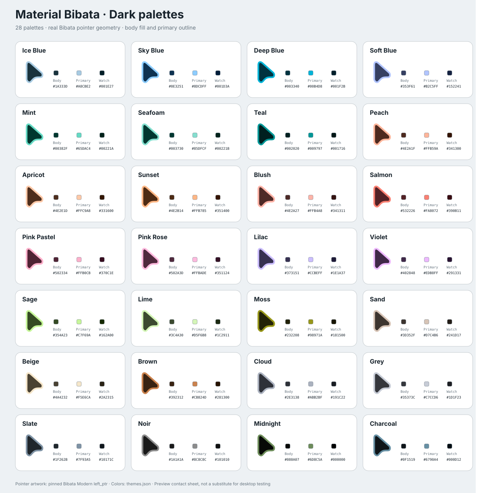
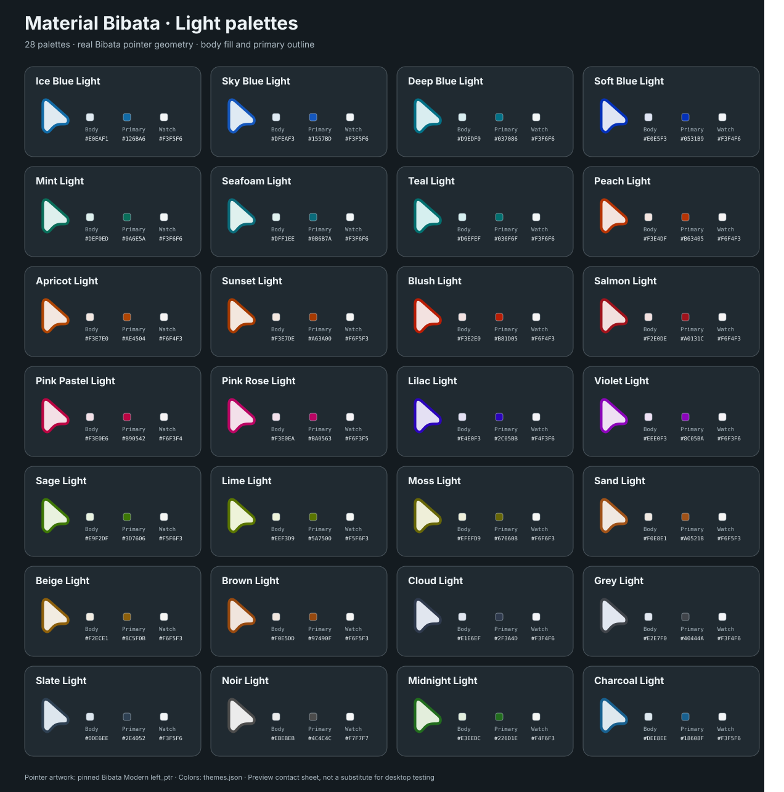

<div align="center">

<picture>
  <source media="(prefers-color-scheme: dark)" srcset="docs/logo-dark.png">
  
</picture>

# Material Bibata Cursor

**57 Bibata cursor themes** built around Material Design 3 colors: 28 dark, 28 light, and the original Classic theme.

Xcursor, Hyprcursor, scalable SVG, and Windows `.cur` / `.ani` assets.

[](https://github.com/SakibShahariar/material-bibata-cursor/releases/latest)
[](https://github.com/SakibShahariar/material-bibata-cursor/actions/workflows/ci.yml)
[](LICENSE)

</div>

## Preview

<div align="center">





</div>

Try the [interactive cursor gallery](https://sakibshahariar.github.io/material-bibata-cursor/).

## Themes

Ice Blue, Sky Blue, Deep Blue, Soft Blue, Mint, Seafoam, Teal, Peach, Apricot, Sunset, Blush, Salmon, Pink Pastel, Pink Rose, Lilac, Violet, Sage, Lime, Moss, Sand, Beige, Brown, Cloud, Grey, Slate, Noir, Midnight, and Charcoal.

Each color has a matching `-Light` variant. **Classic** retains the original Bibata-Modern-Classic colors. Exact values are in [`themes.json`](themes.json).

## Download

Get prebuilt themes from [GitHub Releases](https://github.com/SakibShahariar/material-bibata-cursor/releases/latest).

| Archive | Contents |
|---|---|
| `bibata-material-dark-<version>.tar.gz` | Dark themes + Classic; Linux assets |
| `bibata-material-light-<version>.tar.gz` | Light themes; Linux assets |
| `bibata-material-dark-<version>-win.zip` | Dark themes + Classic; Windows CUR/ANI |
| `bibata-material-light-<version>-win.zip` | Light themes; Windows CUR/ANI |

Linux archives include Xcursor, Hyprcursor, and scalable SVG assets. Each archive includes platform-specific installation instructions.

## Build from source

Requirements: Git (to clone this repository), Python 3.12+, Pillow, librsvg,
and `xorg-xcursorgen`. The pinned upstream Bibata source is vendored in
`scripts/bibata_cursor/`, so building does not fetch anything from the network.

```sh
git clone https://github.com/SakibShahariar/material-bibata-cursor
cd material-bibata-cursor
python3 scripts/build_linux.py
```

The builders use bounded CPU parallelism by default; pass `--jobs 1` to build
themes serially. Output is intentionally concise (progress + summary); pass
`--verbose` (or `just build-verbose`) to see the full build logs.

Common tasks (using [just](https://just.systems/)):

```sh
just build              # all themes
just build-dark         # dark themes + Classic
just build-light        # light themes
just build-one Apricot  # one theme
just apply Apricot      # apply an installed theme
just svg                # scalable SVG assets
just build-win          # Windows CUR/ANI assets
just list
```

To refresh the pinned Bibata source tree, run `just vendor`. See [vendored source notes](scripts/bibata_cursor/VENDORED.md) and [packaging](docs/PACKAGING.md).

## Compatibility and development

The project targets X11, Wayland, GNOME, KDE Plasma, Hyprland, Niri, and Windows. See the [support matrix](docs/SUPPORT.md), [cursor compatibility matrix](docs/COMPATIBILITY.md), and [hotspot QA guide](docs/HOTSPOT_QA.md) for platform-specific coverage and validation status.

CI checks builder tests, theme contrast, cursor-name resolution, representative Linux/Windows builds, and release archive contents.

Research and proposal documents (no shipped behavior changes yet):
- [Cursor architecture and metadata proposal](docs/ARCHITECTURE.md)
- [Semantic cursor color roles](docs/SEMANTIC_ROLES.md)
- [Left-handed cursor research](docs/LEFT_HANDED.md)
- [Animation research](docs/ANIMATION_RESEARCH.md)

More guides:
- [Install and select a theme](docs/INSTALL.md)
- [Cursor size and rendering QA](docs/SIZE_QA.md)
- [SVG cursors](docs/SVG_CURSORS.md)
- [Cursor shapes](docs/CURSOR_SHAPES.md)
- [Windows cursors](docs/WINDOWS.md)
- [Adding a color](docs/COLORS.md)
- [Matugen setup](docs/MATUGEN.md)
- [Cursor authoring](docs/AUTHORING.md)
- [Release checklist](docs/RELEASE.md)

## License and attribution

The build scripts and `themes.json` are **MIT** licensed. Compiled cursor themes are derivative of [Bibata_Cursor](https://github.com/rtgiskard/bibata_cursor) and are **GPL-3.0-or-later**. Redistributed compiled themes must retain the upstream license and attribution; see [LICENSE](LICENSE) and the release archive's `CREDITS.txt`.

Upstream source is pinned to [`f4ccfe8`](https://github.com/rtgiskard/bibata_cursor/tree/f4ccfe8abb63fddc7b3ce51a866fd8378395cb3d). The pin is maintained in `scripts/source_provenance.py`.
