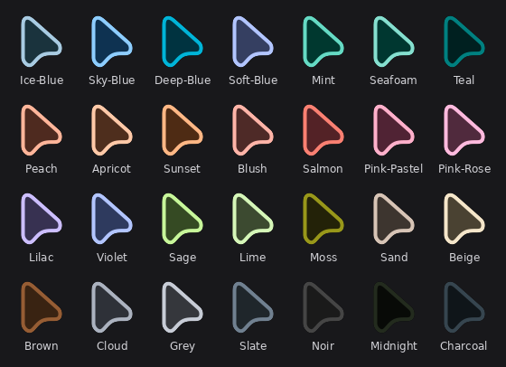
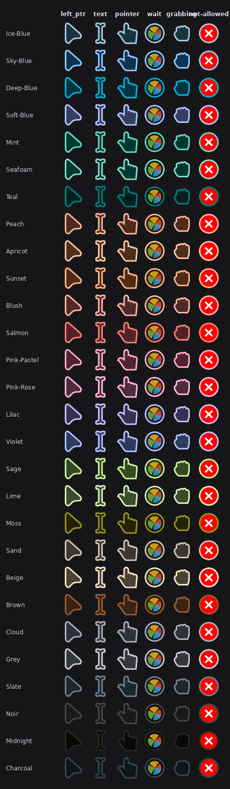
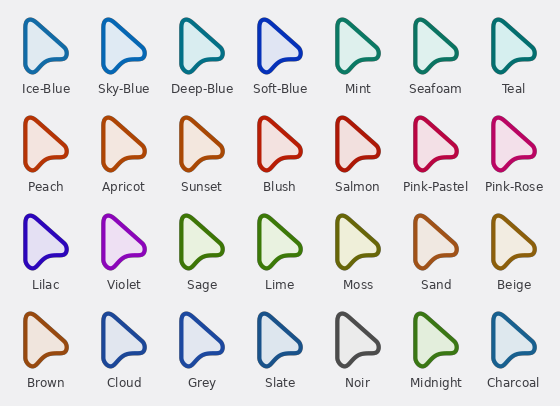
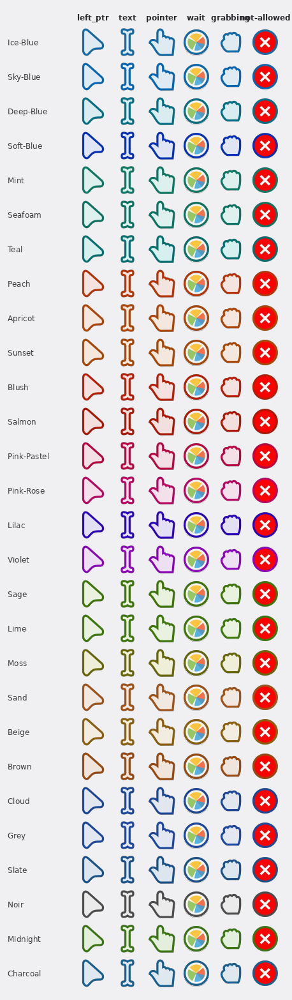

<div align="center">

<picture>
  <source media="(prefers-color-scheme: dark)" srcset="docs/logo-dark.png">
  
</picture>

</div>

# Material Bibata Cursor

57 Bibata cursor themes (28 dark + 28 `-Light` + the original Classic),
colored using Material Design 3's tonal system — a dark body paired
with a vibrant accent outline, tuned independently per theme.

Whatever your setup — X11, Wayland, GNOME 51+, KDE Plasma 6.2+, Hyprland,
Niri, or Windows — choose the matching download or build the formats you need.
Pick a variant below, or add your own color — see
[Adding a color](#adding-a-color).

<div align="center">

[](https://github.com/SakibShahariar/material-bibata-cursor/releases/latest)
[](https://github.com/SakibShahariar/material-bibata-cursor)
[](https://github.com/SakibShahariar/material-bibata-cursor/issues)
[](LICENSE)

</div>

## Contents

[Themes](#themes) · [Install](#install) · [SVG cursors](#svg-cursors) ·
[Windows cursors](#windows-cursors) · [Adding a color](#adding-a-color) ·
[Why body and primary are separate colors](#why-body-and-primary-are-separate-colors) ·
[Files](#files) · [Packaging for redistribution](#packaging-for-redistribution) ·
[Matugen Setup](#matugen-setup) · [License](#license)

## Download a release

Prefer downloading prebuilt themes? Get the latest files from the
[GitHub Releases page](https://github.com/SakibShahariar/material-bibata-cursor/releases/latest).
Linux and Windows downloads are separate archives:

| Archive | Contents |
|---|---|
| `bibata-material-dark-<version>.tar.gz` | 28 dark themes + Classic, with Linux Xcursor, Hyprcursor, and scalable SVG assets |
| `bibata-material-light-<version>.tar.gz` | 28 light themes, with Linux Xcursor, Hyprcursor, and scalable SVG assets |
| `bibata-material-dark-<version>-win.zip` | Windows `.cur` and animated `.ani` files for dark themes + Classic |
| `bibata-material-light-<version>-win.zip` | Windows `.cur` and animated `.ani` files for light themes |

Each archive includes installation instructions appropriate to that platform.
Linux archives include `INSTALL.txt`; Windows ZIPs include `INSTALL.txt` and
the per-theme `Install.inf` files. Linux scalable SVG assets are included for
GNOME 51+ and KDE Plasma 6.2+.

<div align="center">



</div>

## Themes

Ice Blue, Sky Blue, Deep Blue, Soft Blue, Mint, Seafoam, Teal, Peach,
Apricot, Sunset, Blush, Salmon, Pink Pastel, Pink Rose, Lilac, Violet,
Sage, Lime, Moss, Sand, Beige, Brown, Cloud, Grey, Slate, Noir,
Midnight, Charcoal. Exact hex values are in `themes.json`.

There's also **Classic** — the original stock Bibata-Modern-Classic
colors (`#000000` body, `#ffffff` outline), included as-is for anyone
who wants the vanilla look rather than an M3 variant. It's not one of
the 28 (it doesn't follow the Container/Primary design this project is
actually about), just a convenient extra in the same pack.

Each theme's actual range of cursor shapes:

<div align="center">



</div>

### Light versions

Every one of the 28 also has a `-Light` counterpart (e.g. `Ice-Blue-Light`)
— same hue, tone-swapped: a pale/light body instead of a dark one, and a
darker, saturated outline instead of a light one. This mirrors how
Material Design 3 actually defines light vs dark surfaces (it's not a
simple color inversion — light and dark mode swap which tone from the
same palette plays which role). All 28 light variants meet the same
≥4.5 contrast bar as the dark set.

<div align="center">



</div>

Each light theme's range of cursor shapes:

<div align="center">



</div>

## Install

Needs `git` and Python 3.12+, plus whatever `bibata_cursor`
itself needs to build (`librsvg`, `xorg-xcursorgen` — see
[rtgiskard/bibata_cursor](https://github.com/rtgiskard/bibata_cursor)).

```bash
git clone https://github.com/SakibShahariar/material-bibata-cursor
cd material-bibata-cursor
python3 scripts/build_linux.py
```

That installs all 57 (28 dark, 28 light, plus Classic) to `~/.icons`.
Each theme also gets a `cursors_scalable/` SVG export written to
`~/.local/share/icons` (override with `BIBATA_MATERIAL_SCALABLE_DIR`).
That's the format KDE Plasma 6.2+ and **GNOME 51+** actually render in
the compositor — see [SVG cursors](#svg-cursors) below.
The same build also produces `hyprcursors/` for Hyprland, so a single
install covers X11 apps (`cursors/`), GNOME/KDE (the SVGs), and
Hyprland (`hyprctl setcursor Bibata-Material-<Name> 24`).
From there, pick one through GNOME Settings, GNOME Tweaks, or however
your desktop/WM selects a cursor theme — the exact menu depends on your
setup.

A `justfile` provides convenient commands for the Python builder:

```bash
just build              # all 57 (28 dark, 28 light, Classic)
just build-dark         # just the 28 dark themes + Classic
just build-light        # just the 28 light themes
just build-one Apricot  # just one, faster for testing a color
just build-selected Apricot,Coral,Classic  # chosen subset
just remove-selected Apricot,Coral  # preview removal of selected variants
just svg                # (re)generate SVG cursors for installed themes
just svg-one Apricot    # SVG cursors for just one theme
just build-win          # build Windows .cur/.ani assets
just package <version>  # bundle Linux archives, e.g. just package v1.0.0
just package-win <version>       # bundle Windows .cur/.ani ZIPs
just list
just show Apricot
just check-deps
```

For finer control, build a comma-separated subset with `--themes` (or
`just build-selected`). Use `--jobs` to build multiple themes concurrently:

```bash
python3 scripts/build_linux.py --themes Apricot,Coral,Classic
python3 scripts/build_linux.py --themes Apricot,Coral,Classic --jobs 4
just build-selected Apricot,Coral,Classic
```

You can combine `--themes` with `--only-light`/`--only-dark` and
`--exclude`, for example:
`python3 scripts/build_linux.py --themes Ice-Blue-Light,Noir-Light --only-light --exclude Noir-Light`.
Theme names and colors are validated before any theme is built. With no positional theme
or `--themes`, the all-themes default is unchanged. Builds run sequentially by default; use
`--jobs 4` (or another positive integer) to opt into parallel builds.

To remove selected variants from both the Xcursor/Hyprcursor install root and
the scalable SVG root, use a dry run first:

```bash
just remove-selected Apricot,Coral
just remove-selected Apricot,Coral --yes
```

The command only accepts exact names from `themes.json`, removes only the
matching `Bibata-Material-<Name>` directories, and does not follow a theme
directory symlink. The first command only lists what would be removed; pass
`--yes` to perform the deletion. Set `BIBATA_MATERIAL_INSTALL_DIR` and
`BIBATA_MATERIAL_SCALABLE_DIR` to override the install roots, as with the
build command.

## SVG cursors

KDE Plasma 6.2+ and GNOME 51+ render cursor *SVGs* instead of bitmaps:
they expect a `cursors_scalable/<shape>/metadata.json` tree, where each
shape folder holds SVG frames plus a tiny JSON file listing them with
their hotspot. GNOME's compositor (GNOME Shell `st-cursor.c`) only
scans the XDG icon dirs (`~/.local/share/icons`, `/usr/local/share/icons`,
`/usr/share/icons`) — `~/.icons` is never scanned, which is why the SVGs
land in the XDG tree instead of next to the Xcursor pack.

`generate_svg_cursors.py` builds that tree straight from Bibata's SVG
sources (same group/color logic the compile step uses):

- one real directory per cursor shape, named by its X11 name (what KDE
  and X11 apps request), and
- symlinked directories for the CSS cursor names **GNOME/Mutter** looks
  up (`default`, `pointer`, `text`, `ew-resize`, ...), mapped onto the
  same shapes the Xcursor bitmap theme uses, so both renderers draw the
  same arrows (e.g. GNOME's `text` maps to the same `xterm` shape).

The animated `wait`/`left_ptr_watch` cursors keep their 54 frames with a
40ms delay. `nominal_size` is 256 to match Bibata's SVG canvas, so
hotspots and scaling are identical to the bitmap theme's.

If you'd installed themes before SVG export existed, there's nothing to
undo: `just svg` regenerates the scalable tree without recompiling
anything (it only touches `cursors_scalable/`; the Xcursor fallback and
`index.theme` of each theme in `~/.local/share/icons` are symlinked to
the compiled pack).

Cursors are also compiled at more sizes than upstream's default (19
sizes instead of 11) — specifically every exact size a 24px cursor
hits across Plasma/GNOME's fractional display scaling steps (0.5x
through 3x). Without an exact match, some apps scale the nearest
available bitmap instead, which can look blurry on fractional scaling.
This roughly doubles build time (~30s vs ~17s per theme) but doesn't
change anything about how you use the themes.

## Windows cursors

Windows `.cur`/`.ani` cursor files are generated separately using
`scripts/build_windows.py`. This requires Python 3.12 or newer,
`rsvg-convert` (librsvg), and the Python Pillow package. The upstream
Bibata source must also be present in `scripts/bibata_cursor/`; running
the Linux build first clones it automatically. Windows archive packaging
additionally requires `zip`. Check these prerequisites with
`just check-win-deps` before building or packaging Windows themes.

```bash
python3 scripts/build_windows.py             # all themes
python3 scripts/build_windows.py --only-dark  # dark themes only
python3 scripts/build_windows.py --only-light # light themes only
```

Each theme gets a folder under `out_win/` containing a `.cur` file
(16, 24, 32, 48, 64, and 128px) for every static cursor, plus two
animated `.ani` files — `wait.ani` (Busy) and `left_ptr_watch.ani` (Work)
— so the spinner actually spins, reusing the same 54-frame
animation and timing as the Linux cursor.

To install on Windows, open any `Bibata-Material-*` folder, right-click
`Install.inf` and choose **Install** — it copies the `.cur` and `.ani`
files into a per-theme `C:\Windows\Cursors\<theme>\` subfolder and
registers the scheme in the registry, so multiple themes can be
installed side by side (admin prompt). Alternatively copy the theme
folder into `%LOCALAPPDATA%\Icons\` (per-user, no admin) and set the
cursors in **Settings → Devices → Mouse → Additional mouse settings →
Pointers**.

Bundling these into distributable `.zip` archives is covered in
[Packaging for redistribution](#packaging-for-redistribution) below.

## Adding a color

Add an entry to `themes.json`:

```json
"Coral": {
  "body": "#4e2418",
  "primary": "#ff7f50",
  "watch": "#2e130a"
}
```

Then `python3 scripts/build_linux.py Coral` (or
`just build-one Coral`) to build just that one instead of recompiling
everything.

A few guidelines for picking colors that hold up visually:

- **Body**: dark, desaturated, roughly 10-25% lightness. This is the
  neutral fill, not a darker copy of your accent.
- **Primary**: the vibrant one. This carries the actual color.
- **Watch**: near-black, just needs to sit behind the outline.

Preview it with `gsettings set org.gnome.desktop.interface cursor-theme
Bibata-Material-Coral`, or `hyprctl setcursor Bibata-Material-Coral 24`
on Hyprland.

---

## Why body and primary are separate colors

Most themed-cursor setups darken a single accent color and call it a
day — fine against some wallpapers, invisible against others. Picking
body and primary independently (M3's Container/Primary roles) keeps
the cursor legible no matter how bright or saturated the accent is:

| M3 Role | Cursor part | What it does |
|---|---|---|
| Container | Body | Dark, desaturated fill. Stays legible regardless of how bright or saturated the accent is. |
| Primary | Outline | The actual accent color — vibrant, high-chroma. |

For Ice Blue: `Body #1a333d` · `Primary #a8cbe2` · `Watch #0a1f26`.

The same treatment is applied to every palette, so contrast stays
consistent across all 28 themes.

---

## Files

```
themes.json                       # all theme colors, edit this to add/change one
scripts/
├── bibata_cursor/                # build dependency, cloned on first Linux build
├── build_linux.py                # builds themes.json -> ~/.icons (Xcursor + Hyprcursor)
├── compile_bibata_material.fish  # backwards-compatible wrapper for build_linux.py
├── metadata_generator.py         # writes index.theme so GNOME picks it up
├── generate_svg_cursors.py       # writes cursors_scalable/ SVG cursors
├── build_windows.py              # Windows .cur/.ani themes (see "Windows cursors")
├── test_build_linux.py           # unit tests for theme selection and config patching
├── test_install_staged_theme.py  # unit tests for staged asset validation
├── validate_theme_assets.py      # validates cursor outputs and release archives
├── color_match.py                # finds the closest theme color to a hex
├── cursor_matugen.sh             # matugen post-hook (see "Matugen Setup")
└── package_release.sh            # packages already-built themes for release
```

Build flow: the Python Linux builder clones or updates the pinned
`bibata_cursor` source, patches its render config with each theme's colors,
then compiles and installs to
`~/.icons` (Xcursor `cursors/` + Hyprland `hyprcursors/`). `index.theme`
gets written right after each theme installs, so a broken metadata file
gets caught immediately instead of at the end of a 28-theme run. The same
SVG sources are recolored into a `cursors_scalable/` tree under
`$XDG_DATA_HOME/icons`.

## Packaging for redistribution

The packaging script bundles **already-built** themes; it does not
compile them. Build the Linux themes and Windows assets first, then run
the relevant packaging command.

For Linux, build the themes (which also generates scalable SVG assets)
and package them:

```bash
just build
just package v1.0.0
```

This writes two archives by default:

- `dist/bibata-material-dark-v1.0.0.tar.gz` — the 28 dark themes + Classic
- `dist/bibata-material-light-v1.0.0.tar.gz` — the 28 `-Light` themes

Each Linux theme folder contains the Xcursor `cursors/` tree, Hyprland
`hyprcursors/`, and scalable `cursors_scalable/` SVGs where available.
A single archive therefore supports X11 apps, Hyprland, and GNOME 51+ /
KDE Plasma 6.2+.

For Windows, make sure the upstream Bibata source is present, build the
Windows assets, and then package them. If you haven't built the Linux
themes yet, running `just build` first also fetches the upstream source.

```bash
just build-win
just package-win v1.0.0
```

The Windows archives are separate ZIPs:

- `dist/bibata-material-dark-v1.0.0-win.zip` — dark themes + Classic
- `dist/bibata-material-light-v1.0.0-win.zip` — light themes

Each Windows ZIP includes the theme folders with `.cur` files, the
animated `wait.ani` and `left_ptr_watch.ani` cursors, per-theme
`Install.inf` files, and a Windows-specific `INSTALL.txt`.

All Linux archives and Windows ZIPs also include `LICENSE`, `README.md`,
and `CREDITS.txt`, documenting the MIT-licensed tooling and GPLv3-or-later
upstream cursor artwork. The packager writes `dist/SHA256SUMS-<version>.txt`
with SHA-256 checksums for the archives produced for that version.

### Automated releases

Pushing a version tag such as `v1.1.0` runs
`.github/workflows/release.yml`. It builds and validates the Linux and Windows
cursor assets, packages all four archives, checks their contents, and only then
creates or updates the matching GitHub Release. A failed build or validation
step prevents the publish step from running. The workflow uses the repository's
`GITHUB_TOKEN` with the `contents: write` permission to upload release assets;
GitHub Actions must be enabled for the repository.

You can filter the themes with `--only-dark`, `--only-light`, or
`--exclude` when calling `scripts/package_release.sh` directly:

```bash
bash scripts/package_release.sh v1.0.0 --win --only-dark
bash scripts/package_release.sh v1.0.0 --exclude Classic
```

This step is optional for personal use — it is only needed when preparing
downloadable archives for a release or redistribution.

---

## Matugen Setup

Get a theme that matches your wallpaper with
[matugen](https://github.com/InioX/matugen) and the included post-hook:

The hook supports GNOME/GTK, KDE Plasma, Hyprland, Sway, and an opt-in Niri
configuration include. It preserves `XCURSOR_SIZE` when set and otherwise
tries to read the active Hyprland or GNOME cursor size before using 24 as a
fallback.

1. Copy `scripts/cursor_matugen.sh`, `scripts/color_match.py`, and the
   repo's root `themes.json` (looked up next to the script) into
   `~/.config/matugen/post-hook-scripts/`.
2. Add the template to `~/.config/matugen/config.toml`:

```toml
[templates.cursor]
input_path = "~/.config/matugen/templates/cursors.json"
output_path = "~/.config/colors.json"
post_hook = "~/.config/matugen/post-hook-scripts/cursor_matugen.sh"
```

3. Create `~/.config/matugen/templates/cursors.json` with:

```json
{
    "colors": {
        "color13": "{{colors.primary.default.hex}}"
    }
}
```

Before running the hook, build/install the cursor themes (for example,
with `just build`) so the matched preset is available locally. The hook
does **not** build or install themes: it picks the closest preset in
`themes.json` using `color_match.py` and applies that already-installed
theme. It selects the nearest existing palette using CIEDE2000; it
does not recolor or rebuild a cursor to match Matugen's exact primary
hex value, so the result may be close rather than identical. When run
directly from a repository checkout, it finds `themes.json` in the
repository root; when installed as a Matugen post-hook, keep
`themes.json` beside the copied script as described above.

### Niri support

The Matugen post-hook can also update the cursor theme used by
[Niri](https://github.com/niri-wm/niri).

**One-time setup**

Add this line to your Niri configuration, normally
`~/.config/niri/config.kdl`:

```kdl
include "cursor-theme.kdl"
```

If your `config.kdl` already has a `cursor` block with an `xcursor-theme`
setting, remove that setting to avoid having the cursor theme configured
in two places. If the block contains no other settings afterward, you can
remove the entire `cursor` block; keep any other cursor settings you use.

The generated `cursor-theme.kdl` file must be in the same directory as
the main Niri configuration. The Matugen hook updates this file whenever
it runs, selecting the closest installed Bibata Material theme for the
current wallpaper color.

For example, the generated file looks like this:

```kdl
cursor {
    xcursor-theme "Bibata-Material-Teal"
}
```

The theme name in the generated file changes automatically according to
the color selected by the Matugen hook; you do not need to edit the
generated file manually.

**Requirements and notes**

- Install the matching `Bibata-Material-*` cursor themes before running the hook.
- Keep the `include "cursor-theme.kdl"` line in your main Niri configuration so Niri can load the generated setting.
- Niri support has not yet been verified on a live Niri session. If you encounter issues, please report them with your Niri version and configuration details.

## Star History

<div align="center">

<picture>
  <source media="(prefers-color-scheme: dark)" srcset="https://api.star-history.com/svg?repos=SakibShahariar/material-bibata-cursor&type=Date&theme=dark">
  
</picture>

</div>

[Star history for this repository](https://star-history.com/#SakibShahariar/material-bibata-cursor)

## License

Scripts and `themes.json` in this repo are MIT — see `LICENSE`.

The compiled cursor themes are a different story: they're derivative
of [Bibata_Cursor](https://github.com/rtgiskard/bibata_cursor), which
is GPLv3-or-later. If you redistribute compiled themes, that's under
GPLv3, not this repo's MIT license. Not legal advice — check the GPLv3
text if you need to know exactly what that means for your situation.
