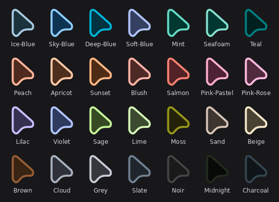
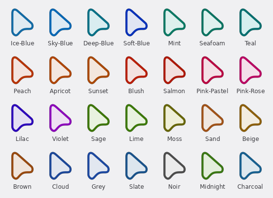

<div align="center">

<picture>
  <source media="(prefers-color-scheme: dark)" srcset="docs/logo-dark.png">
  
</picture>

</div>
# Material Bibata Cursor

57 Bibata cursor themes (28 dark + 28 `-Light` + the original Classic),
colored using Material Design 3's tonal system — a dark body paired
with a vibrant accent outline, tuned independently per theme.

Whatever your setup — X11, Wayland, GNOME 51+, KDE Plasma 6.2+, Hyprland,
Niri, or Windows — choose the matching download or build the formats you need.

<div align="center">

[](https://github.com/SakibShahariar/material-bibata-cursor/releases/latest)
[](https://github.com/SakibShahariar/material-bibata-cursor)
[](https://github.com/SakibShahariar/material-bibata-cursor/issues)
[](https://github.com/SakibShahariar/material-bibata-cursor/actions/workflows/ci.yml)
[](LICENSE)

</div>

## Download a release

Prefer downloading prebuilt themes? Get the latest files from the
[GitHub Releases page](https://github.com/SakibShahariar/material-bibata-cursor/releases/latest).
Linux and Windows downloads are separate archives:

| Archive | Contents |
|---|---|
| `bibata-material-dark-<version>.tar.gz` | 28 dark themes + Classic, with Linux Xcursor, Hyprcursor, and scalable SVG assets |
| `bibata-material-light-<version>.tar.gz` | 28 light themes, with Linux Xcursor, Hyprcursor, and scalable SVG assets |
| `bibata-material-dark-<version>-win.zip` | Windows `.cur` and animated `.ani` files for dark themes + Classic |
| `bibata-material-light-<version>-win.zip` | Windows `.cur` and animated `.ani` files for light themes |

Each archive includes installation instructions appropriate to that platform.

<div align="center">



</div>

## Themes

Ice Blue, Sky Blue, Deep Blue, Soft Blue, Mint, Seafoam, Teal, Peach,
Apricot, Sunset, Blush, Salmon, Pink Pastel, Pink Rose, Lilac, Violet,
Sage, Lime, Moss, Sand, Beige, Brown, Cloud, Grey, Slate, Noir,
Midnight, Charcoal. Exact hex values are in [`themes.json`](themes.json).

There's also **Classic** — the original stock Bibata-Modern-Classic colors,
included for anyone who wants the vanilla look rather than an M3 variant.

Every theme has a `-Light` counterpart with the same hue but a pale/light
body and a darker, saturated outline.

<div align="center">



</div>

## Vendor upstream sources

The build normally uses the Bibata SVG sources and build configuration under
`scripts/bibata_cursor/`. To create or refresh that vendored tree from a pinned
upstream revision, run:

```bash
just vendor
```

Then commit `scripts/bibata_cursor/` so Linux, Windows, and scalable-SVG builds
work without cloning upstream. The vendored commit and license information are
recorded in `scripts/bibata_cursor/VENDORED.md`.

## Install from source

Needs `git`, Python 3.12+, `librsvg`, and `xorg-xcursorgen`.

```bash
git clone https://github.com/SakibShahariar/material-bibata-cursor
cd material-bibata-cursor
python3 scripts/build_linux.py
```

That installs all 57 themes to `~/.icons`, including Xcursor and Hyprcursor
assets, and writes scalable SVG cursors to `~/.local/share/icons`.

Common commands:

```bash
just build              # all themes
just build-dark         # dark themes + Classic
just build-light        # light themes
just build-one Apricot  # one theme
just apply Apricot      # set an installed theme as the active cursor
just svg                # regenerate scalable SVG cursors
just build-win          # Windows .cur/.ani assets
just list
```

See [Packaging for redistribution](docs/PACKAGING.md) to create release archives.

## Quality checks

The [Cursor asset validation workflow](.github/workflows/ci.yml) runs on pushes to
`master`, pull requests, and manual dispatch. It checks builder unit tests,
theme contrast, CSS cursor-name resolution, representative Linux and Windows
builds, generated cursor assets, and Linux/Windows release-archive contents.

For platform coverage and checks that need real desktop or hardware validation,
see the [support matrix](docs/SUPPORT.md), [cursor compatibility matrix](docs/COMPATIBILITY.md),
and [hotspot QA guide](docs/HOTSPOT_QA.md). The [release checklist](docs/RELEASE.md)
collects the broader pre-release checks.

## Documentation

| Guide | Contents |
|---|---|
| [Supported desktops](docs/SUPPORT.md) | Platform support and CI test matrix |
| [SVG cursors](docs/SVG_CURSORS.md) | Scalable SVG format, aliases, and build flow |
| [Cursor shapes](docs/CURSOR_SHAPES.md) | Full shape inventory and name resolution |
| [Compatibility matrix](docs/COMPATIBILITY.md) | Every cursor name: real art, alias, or gap |
| [Windows cursors](docs/WINDOWS.md) | Windows build, installation, and packaging notes |
| [Adding a color](docs/COLORS.md) | Create a theme and understand body/primary colors |
| [Matugen setup](docs/MATUGEN.md) | Match the cursor theme to your wallpaper |
| [Packaging](docs/PACKAGING.md) | Build and distribute release archives |
| [Cursor authoring](docs/AUTHORING.md) | Add or modify cursor shapes |
| [Release checklist](docs/RELEASE.md) | Validate and publish a release |

## License

Scripts and `themes.json` in this repo are MIT — see [`LICENSE`](LICENSE).

The compiled cursor themes are derivative of
[Bibata_Cursor](https://github.com/rtgiskard/bibata_cursor), which is
GPLv3-or-later. If you redistribute compiled themes, that's under GPLv3,
not this repo's MIT license.

## Upstream provenance

Material Bibata uses Bibata's SVG artwork and build metadata from
[Bibata_Cursor](https://github.com/rtgiskard/bibata_cursor), currently pinned to
[`f4ccfe8abb63fddc7b3ce51a866fd8378395cb3d`](https://github.com/rtgiskard/bibata_cursor/tree/f4ccfe8abb63fddc7b3ce51a866fd8378395cb3d).
Upstream supplies cursor shapes and source geometry; this project adds
Material Design 3 palettes/recoloring, the expanded Xcursor size ladder,
CSS/Wayland/Qt name resolution, scalable SVG and Hyprcursor output, and
Windows `.cur`/`.ani` packaging. Original artwork attribution is preserved
in each release archive's `CREDITS.txt`.

The upstream artwork remains GPLv3-or-later; this repository's build tools
and `themes.json` remain MIT. The source URL and commit are centralized in
`scripts/source_provenance.py`, and every release archive records that exact
pin in `CREDITS.txt`. To update Bibata, review the upstream diff and license,
change the single pin, regenerate and validate every output format, and
preserve attribution. Full checked-in source vendoring is tracked separately
in #40; until that is complete, builders materialize the pinned upstream
source when needed.

## Star History

<div align="center">

<picture>
  <source media="(prefers-color-scheme: dark)" srcset="https://api.star-history.com/svg?repos=SakibShahariar/material-bibata-cursor&type=Date&theme=dark">
  
</picture>

</div>
